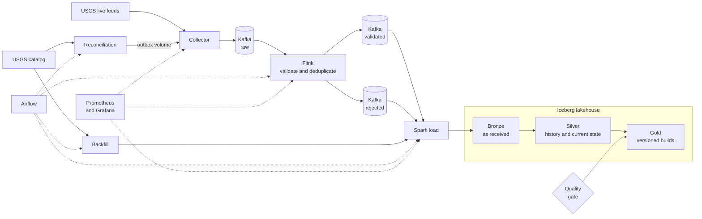

<div align="center">

# QuakeFlow

**A real-time earthquake data platform that gets revisions right.**

Streaming and batch data engineering on real USGS data, built with Kafka, Flink, Spark, Apache Iceberg and Airflow. It runs on one laptop with Docker, with no paid services and no cloud account.

[](https://github.com/viditpawar/QuakeFlow/actions/workflows/ci.yml)
[](LICENSE)


[The problem](#the-problem) · [How it works](#how-it-works) · [Proven by tests](#proven-by-tests) · [Performance](#performance) · [Quick start](#quick-start) · [Documentation](#documentation) · [Limitations](#limitations)

</div>

> QuakeFlow is a data engineering project. It is not an earthquake prediction or warning system.

## At a glance

| | |
|---|---|
| **What it does** | Collects live and historical earthquake records from USGS, keeps every distinct revision of each event that it observes, and serves reliable, quality-checked analytics. Airflow runs the batch work on a schedule |
| **Delivery guarantees** | Checkpointed, transactional Kafka stream processing with idempotent Iceberg ingestion and tested replay recovery. The collector delivers at least once, Flink writes to Kafka transactionally, and the Iceberg merges guarantee that each revision is stored once |
| **Data** | Real, public USGS earthquake feeds and catalog, with no API key. Only the tests and the benchmarks use synthetic data |
| **Stack** | Python, Apache Kafka, Apache Flink, PySpark, Apache Iceberg, Apache Airflow, PostgreSQL, Prometheus, Grafana |
| **Runs on** | One machine with Docker Desktop and about 16 GB of RAM |
| **Cost** | $0 |
| **Status** | All planned phases built, tested and run on real data. A learning and portfolio project, not a production service |

## The problem

USGS does not publish an earthquake once and leave it. It keeps refining the record, sometimes hours or days later: the magnitude changes, the location moves, the review status goes from *automatic* to *reviewed*.

A simple pipeline treats each report as a new earthquake. Here is what happens to one event, shown with illustrative values:

| Report | Magnitude | Status | Simple pipeline | QuakeFlow |
|---|---|---|---|---|
| 10:00 first report | 4.6 | automatic | counts 1 earthquake | stores revision 1, current = 4.6 |
| 10:42 USGS revises it | 4.8 | reviewed | counts **2 earthquakes** | stores revision 2, current = **4.8** |
| 10:50 the 10:00 report arrives again, late | 4.6 | automatic | counts **3 earthquakes** | recognises it, current stays **4.8** |

QuakeFlow identifies each revision by a fingerprint of its content, keeps every distinct revision it observes, and always exposes exactly one current version per event. It can only keep what it sees: a revision made and replaced between two looks, or before the platform first saw the event, is not recoverable from USGS. The same rule applies to the live feed, to repeated deliveries, to the reconciliation job and to historical backfills.

This matters on real data. In one day, 19 events were revised: 9 changed review status, 7 changed depth, 7 changed location, 7 changed event time and only 5 changed magnitude. A pipeline that watched magnitude alone would have missed most of the changes ([details](docs/verification-log.md)).

## How it works



| Component | Role | Built with |
|---|---|---|
| **Collector** | Polls two USGS feeds on separate schedules, validates and fingerprints each record, and sends only revisions it has not sent before. A revision counts as sent only after Kafka confirms it. It is also the only writer of its state, so it takes over reconciliation batches from a shared volume | Python, Pydantic, SQLite |
| **Kafka** | Durable, replayable buffer between the stages, with its data on a volume. Events are keyed by event id so all revisions of one earthquake stay in order | Apache Kafka (KRaft) |
| **Flink job** | Validates every message, drops repeats, and routes bad records to a rejected topic with the reason. Output is written with Kafka transactions, so it is exactly-once within Flink (the guarantee across the whole pipeline comes from the idempotent merges downstream) | Flink SQL |
| **Spark load** | Merges Kafka into the lakehouse. Every write is safe to repeat, so a failed or repeated run changes nothing. Each load records the Silver snapshots it ended with | PySpark, Iceberg |
| **Quality gate and Gold** | Audits the data and the results against a written contract. A passing build is stored under its own build id and becomes visible in one commit, so readers see one build in full, and an earlier build can be published again | YAML contract, Spark SQL |
| **Airflow** | Runs the pipeline every 30 minutes, the reconciliation every 6 hours and a manual backfill, with retries, run history and one Spark container at a time. Another DAG checks the Flink job every 5 minutes and submits it again from its checkpoint if it was lost | Apache Airflow, Docker |
| **Reconciliation** | Asks the catalog for everything updated since its watermark (with an overlap) and hands it to the collector through a file outbox. The watermark moves only when the collector has durably accepted the batch | Python, Airflow |
| **Backfill** | Downloads historical windows, splits any that exceed the catalog's 20,000-event limit, records a checksummed manifest per window, and verifies the range is in Silver | Python, PySpark |
| **Observability** | Metrics, a dashboard and alert rules for every stage | Prometheus, Grafana |

### The lakehouse

| Layer | Holds | Why |
|---|---|---|
| **Bronze** | Records exactly as received, with where they came from | Replay and debugging without going back to the source |
| **Silver** | Every distinct revision observed of every event, one current row per event, rejected records with reasons, and a log of the Silver snapshots each load ended with | The trusted record of what happened |
| **Gold** | Daily activity, regional activity, magnitude distribution, revision statistics, ingestion latency, as views over the published build | Ready-to-query analytics, published only when the quality gate passes |

Tables live in Apache Iceberg, with metadata in PostgreSQL and files in S3-compatible RustFS. More detail, including what each stage guarantees and where its state lives, is in [docs/architecture.md](docs/architecture.md).

## Proven by tests

Each row below was tested by causing the failure and then checking the data. Several of the tests were also run against a deliberately broken version of the code, to confirm that they fail when they should. The [verification log](docs/verification-log.md) lists which, and also what each test does not show.

| What goes wrong | What happens |
|---|---|
| The same revision is sent many times | One accepted current row |
| An older revision arrives after a newer one | The newer one stays current, and the older is kept as history |
| Kafka goes down while the collector runs | Revisions wait and are delivered after recovery: 8 of 8 arrived, once each |
| Kafka is down for six minutes | The Flink job keeps retrying and resumes on its own, caught up 28 seconds after Kafka returned |
| A Flink worker is killed mid-stream | The job restores from its checkpoint: 400 of 400 revisions, once each |
| A Flink job is cancelled | The `flink_health` DAG submits it again from its last checkpoint. On the real job it resumed from checkpoint 1540 of the old job. Without a checkpoint it refuses and waits for a person |
| Kafka loses messages the collector had confirmed | The collector's state file holds every revision, so they are sent again: 23 of 23 recovered in the one real case |
| A Spark load is killed part way | Tables can disagree until the retry, then are exactly right |
| A load starts while Gold is being built | Gold reads the Silver snapshots its load recorded, so the newer data is not in that build |
| A backfill is run twice, or ranges overlap | Row counts do not change |
| A reconciliation window overlaps the last one | The same 1,101 events came back and 0 new revisions were recorded |
| The collector stops after committing a batch and before answering | The batch is found again and answered without recording anything twice |
| A record is corrupt | It is quarantined with the reason and the rest continue |
| Bad data reaches Silver | The quality gate blocks the build and the previous analytics stay in place |

## Performance

Measured on one laptop (12th Gen Intel Core i5-12500H, Docker Desktop with 16 CPUs and 7.6 GB), with one Kafka broker and Flink at parallelism 1, on synthetic data that is 10% revisions and 10% exact repeats. Each size was run twice, and 200,000 once. A cell shows the middle of the runs with the range in brackets.

| Revisions | Through Kafka and Flink (per s) | Spark ingest (per s) | Gold build (s) | Peak memory, all containers (MiB) |
| --- | --- | --- | --- | --- |
| 2,000 | 528 (404 to 652) | 65 (49 to 81) | 61.1 (60.7 to 61.5) | 5,134 (5,123 to 5,145) |
| 10,000 | 1,007 (906 to 1,109) | 392 (369 to 415) | 54.6 (51.4 to 57.8) | 5,092 (5,034 to 5,151) |
| 40,000 | 3,116 (2,357 to 3,876) | 1,112 (1,090 to 1,133) | 62.5 (54.9 to 70.1) | 5,346 (5,316 to 5,377) |
| 200,000 (one run) | 7,749 | 1,340 | 64.1 | 5,456 |

These numbers are for this machine and this data. The Kafka and Flink rate is a floor, because it includes waiting for a 10 second checkpoint. On this setup Spark ingestion is the slowest stage, at about 1,300 revisions a second, and the pipeline is far faster than USGS produces data (about 1,100 updates in two days), but this is not what a production cluster would do. The benchmarks also found two defects, a Kafka retention rule that could delete replayed revisions and a Spark container that was too small, and both are fixed ([D-032, D-033](decisions.md)). Method, caveats and the raw results are in [docs/benchmarks.md](docs/benchmarks.md).

## Quick start

**You need** Docker Desktop, Python 3.11 and about 16 GB of RAM. The commands are for PowerShell and run from the repository root.

**1. Install**

```powershell
py -3.11 -m venv .venv
.\.venv\Scripts\Activate.ps1
pip install -e ".[dev]"
```

**2. Start Kafka and create its topics**

```powershell
docker compose --profile core up -d --build
python infrastructure\kafka\create_topics.py
```

**3. Collect real earthquakes**

The collector started with Kafka. Watch it poll USGS and publish:

```powershell
docker logs --tail 6 quakeflow-collector
```

You should see one line per feed, then Kafka confirming delivery. The numbers depend on what USGS has published, and the day feed holds far more events than the hour feed. For example:

```
feed all_hour: 8 fetched, 8 changes {'new': 8}, 0 rejected, 8 pending
kafka: delivered 8 revisions to quakeflow.events.raw
```

**4. Look at the data**

```powershell
docker exec quakeflow-kafka /opt/kafka/bin/kafka-console-consumer.sh --bootstrap-server localhost:19092 --topic quakeflow.events.raw --from-beginning --max-messages 3
```

Each message is one earthquake revision as JSON, with its fingerprint (`record_hash`).

**5. Go further**

Add Flink, the lakehouse, Airflow, the analytics layer and monitoring. [docs/running.md](docs/running.md) has every command, in order. To run the batch work on a schedule:

```powershell
python scripts\airflow_setup.py      # once: generates the Airflow secrets and its database
docker compose --profile core --profile streaming --profile batch --profile orchestration up -d
```

The Airflow UI is at http://127.0.0.1:8080 (user `quakeflow`, password in `secrets/airflow_passwords.json`). The DAGs start paused.

The services are split into Compose profiles (`core`, `streaming`, `batch`, `monitoring`, `orchestration`), so you only run what you need. With everything running, the containers used about 2.9 GB at idle (measured), and a Spark job adds up to its 3 GB limit while it runs.

## Testing

| | Command | Takes |
|---|---|---|
| Unit tests (481) | `python -m pytest` | a few seconds |
| Lint | `python -m ruff check .` | seconds |
| Configuration | `python scripts\validate_config.py` | seconds |
| Integration and recovery (21) | `python -m pytest -m integration` | 1 to 10 minutes each, about 40 minutes for the Gold file alone, needs the stack running |
| Benchmarks | `python -m benchmarks.run_benchmark` | about 4 minutes per run, pause the Airflow DAGs first |

GitHub Actions runs the lint, unit tests, configuration checks, Compose validation and alert-rule tests on every push, and builds the Docker images when the files that define them change. The integration tests need several gigabytes of memory and are run locally.

## Repository layout

```
ingestion/        collector: USGS clients, change detector, Kafka publisher, outbox, reconciliation commands
schemas/          the earthquake event model
processing/       normalization and record fingerprinting
batch/            Spark jobs, historical backfill, quality gate, load log
flink/            the streaming job in Flink SQL, and the script that submits it again
airflow/dags/     the DAGs: incremental pipeline, reconciliation, historical backfill, Flink health
iceberg/          table definitions, merge statements, Spark catalog settings
configs/          feed list, Kafka topics, data quality contract
monitoring/       Prometheus rules, Grafana dashboard and provisioning
docker/           collector, Flink, Spark and Airflow images
infrastructure/   topic and bucket creation scripts
scripts/          configuration validation, Airflow setup
benchmarks/       the benchmark suite and its results
tests/            unit, integration and recovery tests
docs/             architecture, data dictionary, monitoring, runbook, benchmarks, verification log
decisions.md      the design decisions and the reasoning behind them
```

## Documentation

| Read this | To learn |
|---|---|
| [docs/architecture.md](docs/architecture.md) | How the pieces fit, what each stage guarantees, where state lives |
| [docs/running.md](docs/running.md) | Every command to run and operate the platform, including the Airflow DAGs |
| [docs/data-dictionary.md](docs/data-dictionary.md) | Every table and column, and exactly how each analytic is defined |
| [docs/monitoring.md](docs/monitoring.md) | The metrics, the dashboard and the alerts |
| [docs/recovery-runbook.md](docs/recovery-runbook.md) | What survives each failure, and how to recover |
| [docs/benchmarks.md](docs/benchmarks.md) | How the platform was measured, the results, and what they do not show |
| [docs/verification-log.md](docs/verification-log.md) | What was run on real data, what it showed, and what it did not show |
| [decisions.md](decisions.md) | Each major design decision, the options considered, and the trade-offs |

## Limitations

These are stated plainly because they affect how far the results can be trusted.

- **Single machine.** One Kafka broker, one Flink worker, one Airflow scheduler, and no JobManager high availability. It survives process failures, not the loss of the machine, and nothing is backed up.
- **Airflow is set up for a trusted laptop.** It uses the development login manager with one generated password, and its scheduler holds the Docker socket, which is equivalent to root on the Docker host. It is bound to 127.0.0.1 only. Anyone who can edit the DAG files or log in as admin can start any container ([D-027](decisions.md)).
- **Delay before data reaches the lakehouse.** The Spark load runs every 30 minutes, so Silver and Gold lag Kafka by up to that long. A lost Flink job is brought back within about 5 minutes. Nothing alerts yet when a DAG run fails: Prometheus evaluates its rules but nothing is sent anywhere.
- **At-least-once delivery.** A revision can be sent twice. Repeats are removed by fingerprint, so the results are correct. Flink's own repeat filter forgets after 7 days, so a revision replayed after that passes through Flink again, and the Iceberg merges are what keep it stored once ([architecture](docs/architecture.md#what-is-guaranteed-end-to-end)).
- **Briefly inconsistent Silver tables during a load.** Each Silver table is a separate commit, so they can disagree until a load finishes. Gold is not affected: it reads the snapshots a finished load recorded.
- **Not every revision is observed.** The reconciliation job looks every 6 hours, and the catalog returns each event's current state only. A revision that is replaced between two looks, or made before the platform first saw the event, is never seen. Reconciled revisions travel the live path, so they also show up in the ingestion latency statistics with a long delay.
- **Analytics describe loaded data only.** Gold reflects what has been loaded, not the whole USGS catalog, and periods loaded with different magnitude filters are not directly comparable.
- **The benchmarks are synthetic and single-machine.** They bound what this setup can do, and say nothing about real USGS bursts or a cluster ([docs/benchmarks.md](docs/benchmarks.md)).

## Data sources and notice

- Live: USGS earthquake GeoJSON feeds, https://earthquake.usgs.gov/earthquakes/feed/
- Historical: USGS FDSN Event Web Service, https://earthquake.usgs.gov/fdsnws/event/1/

USGS data is public and needs no API key. Credit USGS as the source. This repository contains code, schemas, documentation, tests and small synthetic fixtures only. This project is not affiliated with or endorsed by USGS.

## License

Released under the [MIT License](LICENSE).
