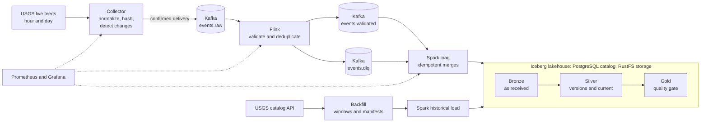

# QuakeFlow — Real-Time Earthquake Data Engineering Platform

[](https://github.com/viditpawar/QuakeFlow/actions/workflows/ci.yml)
[](LICENSE)

A streaming and batch data platform that ingests real USGS earthquake data, keeps every revision of each event, and maintains an Apache Iceberg lakehouse with quality-gated analytics. It runs on one laptop with Docker, uses no paid services, and needs no cloud account.

QuakeFlow is a data engineering project. It is not an earthquake prediction or warning system.

## The problem it solves

USGS revises earthquakes after publishing them. An event first reported at magnitude 4.6 may later become 4.8, move a few kilometres, or change from "automatic" to "reviewed". A simple pipeline stores those as separate earthquakes and double counts them.

QuakeFlow recognises that both records describe the same event. It keeps each revision, maintains one current version per event, and makes sure that a late or old record never overwrites a newer one. The same rule applies whether a record arrives from the live feed, a repeat delivery, or a historical backfill.

In a day of real data, 19 events were revised: 9 changed review status, 7 changed depth, 7 changed location, 7 changed event time and 5 changed magnitude. A pipeline that only watched magnitude would have missed most of them ([verification log](docs/verification-log.md)).

## How it works



1. **Collector** polls two USGS feeds on separate schedules, validates each record, fingerprints its content, and remembers which revisions it has seen in SQLite. A revision counts as sent only after Kafka confirms it, so a crash or an outage delays data and never loses it.
2. **Flink** validates and deduplicates the stream with exactly-once output. Bad records go to a dead-letter topic with the reason, and a late older revision is still kept as a version.
3. **Spark** loads Kafka into Iceberg with merges that are safe to repeat. Silver holds every revision plus one current row per event.
4. **Backfill** downloads historical windows from the catalog API, splitting any window over the service's 20,000-event limit, and records a checksummed manifest per window so it can resume.
5. **Gold** analytics are rebuilt behind a quality gate. If any check fails, nothing is published and the previous tables stay in place.

More detail, including what each hop guarantees, is in [docs/architecture.md](docs/architecture.md). The reasoning behind each major choice is in [decisions.md](decisions.md).

## What is in it

| Area | What |
|---|---|
| Ingestion | Python collector, Pydantic validation, deterministic record hash, SQLite change detector, Kafka publisher |
| Streaming | Apache Kafka (KRaft), Apache Flink SQL with checkpoints and exactly-once sinks |
| Batch | PySpark jobs, Iceberg Bronze / Silver / Gold tables, historical backfill |
| Quality | Declarative quality contract, write-audit-publish gate, reconciliation of every Gold table against Silver |
| Operations | Prometheus metrics and alerts, Grafana dashboard, recovery runbook, failure-injection tests |
| Delivery | Docker Compose profiles, GitHub Actions, version-pinned and checksum-verified downloads |

Versions: Kafka 3.9.0, Flink 2.2.1, Spark 4.0.4, Iceberg 1.12.0, PostgreSQL 17, RustFS 1.0.0, Python 3.11.

## Quick start

You need Docker Desktop, Python 3.11 and about 16 GB of RAM. Everything runs on localhost. These are PowerShell commands, run from the repository root.

```powershell
py -3.11 -m venv .venv
.\.venv\Scripts\Activate.ps1
pip install -e ".[dev]"

docker compose --profile core up -d            # Kafka
python infrastructure\kafka\create_topics.py   # first time only
python -m ingestion.live.poller --once         # poll both feeds once and publish to Kafka
```

Then add Flink, the lakehouse, backfills, Gold and monitoring as you like. [docs/running.md](docs/running.md) has every command. With everything running, the containers used about 2.3 GB when idle (measured), and a Spark job adds up to its 2 GB limit while it runs. The services are split into Compose profiles (`core`, `streaming`, `batch`, `monitoring`) so you can run only the ones you need.

## Tests

```powershell
python -m pytest                       # about 300 unit tests, a few seconds
python -m ruff check .                 # lint
python scripts\validate_config.py      # configuration files, dashboards, contracts
```

Eleven integration and recovery tests run against the real Kafka, Flink, Spark and Iceberg, and need the stack running. Run them with `python -m pytest -m integration`. Each takes between one and ten minutes. They kill a Flink worker mid-stream, interrupt a Spark load, feed corrupt records through, and break the data quality gate on purpose. Where a test was meant to catch a failure, it was also run against a deliberately broken version to confirm it fails.

GitHub Actions runs the lint, unit tests, configuration validation, Compose validation and alert-rule tests on every push. It builds the Docker images when files that affect them change. The heavy integration tests are not run there, because they need several gigabytes of memory.

## Repository layout

```
ingestion/        collector: USGS clients, change detector, Kafka publisher, metrics
schemas/          the earthquake event model
processing/       normalization and record hashing
batch/            Spark jobs, historical backfill, quality gate
flink/sql/        the streaming job, written in Flink SQL
iceberg/          table definitions, merge statements, Spark catalog settings
configs/          feed list, Kafka topics, data quality contract
monitoring/       Prometheus rules, Grafana dashboard and provisioning
docker/           Flink and Spark images
infrastructure/   topic and bucket creation scripts
scripts/          configuration validation
tests/            unit, integration and recovery tests
docs/             architecture, data dictionary, monitoring, runbook, verification log
decisions.md      the design decisions and their reasoning
```

## Documentation

| | |
|---|---|
| [docs/architecture.md](docs/architecture.md) | Data flow, guarantees at each step, resource use |
| [docs/running.md](docs/running.md) | Every command for running and operating the platform |
| [docs/data-dictionary.md](docs/data-dictionary.md) | Every table and column, and how the analytics are defined |
| [docs/monitoring.md](docs/monitoring.md) | Metrics, dashboard and alerts |
| [docs/recovery-runbook.md](docs/recovery-runbook.md) | What survives each failure, and how to recover |
| [docs/verification-log.md](docs/verification-log.md) | What was run on real data, what it showed, and what it did not show |
| [decisions.md](decisions.md) | Design decisions, the options considered, and the trade-offs |

## Limitations

Stated plainly, because they affect how far the results can be trusted:

- It is a single-machine learning and portfolio project. There is one Kafka broker, one Flink TaskManager and no JobManager high availability, so it is not fault tolerant against losing a machine.
- Delivery is at-least-once. Duplicates are removed by content hash, so the results are correct, but a revision can be sent twice.
- The Spark load and Gold build are run by hand or on a schedule you set. Data reaches the lakehouse only when they run.
- The lakehouse tables can disagree briefly while a load is running, because each table is a separate commit. They are consistent once a load completes.
- Revisions that USGS makes after an event leaves the one-day feed are not seen yet. A scheduled reconciliation job is planned in [decisions.md](decisions.md) (D-003) and not built.
- The USGS catalog returns each event's current state, so a backfill cannot recover earlier revisions.
- The lakehouse holds only what has been loaded so far. Gold analytics describe that data and not the whole USGS catalog, and periods loaded with different magnitude filters are not directly comparable.
- No performance benchmarks have been made. The measurements that exist are in the verification log.

## Data sources and notice

- Live: USGS earthquake GeoJSON feeds, https://earthquake.usgs.gov/earthquakes/feed/
- Historical: USGS FDSN Event Web Service, https://earthquake.usgs.gov/fdsnws/event/1/

USGS data is public and needs no API key. Credit USGS as the source. This repository contains code, schemas, documentation, tests and small synthetic fixtures only, and this project is not affiliated with or endorsed by USGS.

## License

MIT. See [LICENSE](LICENSE).
