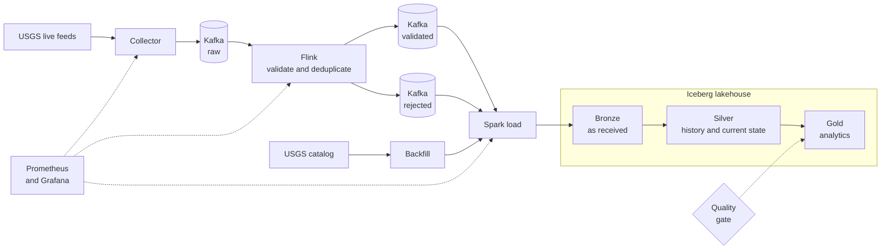

<div align="center">

# QuakeFlow

**A real-time earthquake data platform that gets revisions right.**

Streaming and batch data engineering on real USGS data, built with Kafka, Flink, Spark and Apache Iceberg. It runs on one laptop with Docker, with no paid services and no cloud account.

[](https://github.com/viditpawar/QuakeFlow/actions/workflows/ci.yml)
[](LICENSE)


[The problem](#the-problem) · [How it works](#how-it-works) · [Proven by tests](#proven-by-tests) · [Quick start](#quick-start) · [Documentation](#documentation) · [Limitations](#limitations)

</div>

> QuakeFlow is a data engineering project. It is not an earthquake prediction or warning system.

## At a glance

| | |
|---|---|
| **What it does** | Collects live and historical earthquake records from USGS, keeps every revision of each event, and serves reliable, quality-checked analytics |
| **Data** | Real, public USGS earthquake feeds and catalog, with no API key. Only the tests use small synthetic fixtures |
| **Stack** | Python, Apache Kafka, Apache Flink, PySpark, Apache Iceberg, PostgreSQL, Prometheus, Grafana |
| **Runs on** | One machine with Docker Desktop and about 16 GB of RAM |
| **Cost** | $0 |
| **Status** | All planned phases built and tested. A learning and portfolio project, not a production service |

## The problem

USGS does not publish an earthquake once and leave it. It keeps refining the record, sometimes hours later: the magnitude changes, the location moves, the review status goes from *automatic* to *reviewed*.

A simple pipeline treats each report as a new earthquake. Here is what happens to one event, shown with illustrative values:

| Report | Magnitude | Status | Simple pipeline | QuakeFlow |
|---|---|---|---|---|
| 10:00 first report | 4.6 | automatic | counts 1 earthquake | stores revision 1, current = 4.6 |
| 10:42 USGS revises it | 4.8 | reviewed | counts **2 earthquakes** | stores revision 2, current = **4.8** |
| 10:50 the 10:00 report arrives again, late | 4.6 | automatic | counts **3 earthquakes** | recognises it, current stays **4.8** |

QuakeFlow identifies each revision by a fingerprint of its content, keeps the full history, and always exposes exactly one current version per event. The same rule applies to the live feed, to repeated deliveries, and to historical backfills.

This matters on real data. In one day, 19 events were revised: 9 changed review status, 7 changed depth, 7 changed location, 7 changed event time and only 5 changed magnitude. A pipeline that watched magnitude alone would have missed most of the changes ([details](docs/verification-log.md)).

## How it works



| Component | Role | Built with |
|---|---|---|
| **Collector** | Polls two USGS feeds on separate schedules, validates and fingerprints each record, and sends only revisions it has not sent before. A revision counts as sent only after Kafka confirms it | Python, Pydantic, SQLite |
| **Kafka** | Durable, replayable buffer between the stages. Events are keyed by event id so all revisions of one earthquake stay in order | Apache Kafka (KRaft) |
| **Flink job** | Validates every message, drops repeats, and routes bad records to a rejected topic with the reason. Output is exactly-once | Flink SQL |
| **Spark load** | Merges Kafka into the lakehouse. Every write is safe to repeat, so a failed or repeated run changes nothing | PySpark, Iceberg |
| **Backfill** | Downloads historical windows, splits any that exceed the catalog's 20,000-event limit, and records a checksummed manifest per window so it can resume | Python, PySpark |
| **Quality gate** | Audits the data and the results against a written contract, and publishes analytics only if every check passes | YAML contract, Spark SQL |
| **Observability** | Metrics, a dashboard and alert rules for every stage | Prometheus, Grafana |

### The lakehouse

| Layer | Holds | Why |
|---|---|---|
| **Bronze** | Records exactly as received, with where they came from | Replay and debugging without going back to the source |
| **Silver** | Every revision of every event, one current row per event, and rejected records with reasons | The trusted record of what happened |
| **Gold** | Daily activity, regional activity, magnitude distribution, revision statistics, ingestion latency | Ready-to-query analytics, rebuilt only when the quality gate passes |

Tables live in Apache Iceberg, with metadata in PostgreSQL and files in S3-compatible RustFS. More detail, including what each stage guarantees and where its state lives, is in [docs/architecture.md](docs/architecture.md).

## Proven by tests

Each row below was tested by causing the failure and then checking the data. Several of the tests were also run against a deliberately broken version of the code, to confirm that they fail when they should. The [verification log](docs/verification-log.md) lists which.

| What goes wrong | What happens |
|---|---|
| The same revision is sent many times | One accepted current row |
| An older revision arrives after a newer one | The newer one stays current, and the older is kept as history |
| Kafka goes down while the collector runs | Revisions wait and are delivered after recovery: 8 of 8 arrived, once each |
| Kafka is down for six minutes | The Flink job keeps retrying and resumes on its own, caught up 28 seconds after Kafka returned |
| A Flink worker is killed mid-stream | The job restores from its checkpoint: 400 of 400 revisions, once each |
| A Flink job is cancelled and restarted | State is restored from the checkpoint. Without it, every revision is emitted again |
| A Spark load is killed part way | Tables can disagree until the retry, then are exactly right |
| A backfill is run twice, or ranges overlap | Row counts do not change |
| A record is corrupt | It is quarantined with the reason and the rest continue |
| Bad data reaches Silver | The quality gate blocks the build and the previous analytics stay in place |

## Quick start

**You need** Docker Desktop, Python 3.11 and about 16 GB of RAM. The commands are for PowerShell and run from the repository root.

**1. Install**

```powershell
py -3.11 -m venv .venv
.\.venv\Scripts\Activate.ps1
pip install -e ".[dev]"
```

**2. Start Kafka and create its topics**

```powershell
docker compose --profile core up -d
python infrastructure\kafka\create_topics.py
```

**3. Collect real earthquakes**

```powershell
python -m ingestion.live.poller --once
```

You should see one line per feed, then Kafka confirming delivery. The numbers depend on what USGS has published, and the day feed holds far more events than the hour feed. For example:

```
feed all_hour: 8 fetched, 8 changes {'new': 8}, 0 rejected, 8 pending
kafka: delivered 8 revisions to quakeflow.events.raw
```

**4. Look at the data**

```powershell
docker exec quakeflow-kafka /opt/kafka/bin/kafka-console-consumer.sh --bootstrap-server localhost:19092 --topic quakeflow.events.raw --from-beginning --max-messages 3
```

Each message is one earthquake revision as JSON, with its fingerprint (`record_hash`).

**5. Go further**

Add Flink, the lakehouse, historical backfills, the analytics layer and monitoring. [docs/running.md](docs/running.md) has every command, in order.

The services are split into Compose profiles (`core`, `streaming`, `batch`, `monitoring`), so you only run what you need. With everything running, the containers used about 2.3 GB at idle (measured), and a Spark job adds up to its 2 GB limit while it runs.

## Testing

| | Command | Takes |
|---|---|---|
| Unit tests (315) | `python -m pytest` | a few seconds |
| Lint | `python -m ruff check .` | seconds |
| Configuration | `python scripts\validate_config.py` | seconds |
| Integration and recovery (11) | `python -m pytest -m integration` | 1 to 10 minutes each, needs the stack running |

GitHub Actions runs the lint, unit tests, configuration checks, Compose validation and alert-rule tests on every push, and builds the Docker images when the files that define them change. The integration tests need several gigabytes of memory and are run locally.

## Repository layout

```
ingestion/        collector: USGS clients, change detector, Kafka publisher, metrics
schemas/          the earthquake event model
processing/       normalization and record fingerprinting
batch/            Spark jobs, historical backfill, quality gate
flink/sql/        the streaming job, written in Flink SQL
iceberg/          table definitions, merge statements, Spark catalog settings
configs/          feed list, Kafka topics, data quality contract
monitoring/       Prometheus rules, Grafana dashboard and provisioning
docker/           Flink and Spark images
infrastructure/   topic and bucket creation scripts
scripts/          configuration validation
tests/            unit, integration and recovery tests
docs/             architecture, data dictionary, monitoring, runbook, verification log
decisions.md      the design decisions and the reasoning behind them
```

## Documentation

| Read this | To learn |
|---|---|
| [docs/architecture.md](docs/architecture.md) | How the pieces fit, what each stage guarantees, where state lives |
| [docs/running.md](docs/running.md) | Every command to run and operate the platform |
| [docs/data-dictionary.md](docs/data-dictionary.md) | Every table and column, and exactly how each analytic is defined |
| [docs/monitoring.md](docs/monitoring.md) | The metrics, the dashboard and the alerts |
| [docs/recovery-runbook.md](docs/recovery-runbook.md) | What survives each failure, and how to recover |
| [docs/verification-log.md](docs/verification-log.md) | What was run on real data, what it showed, and what it did not show |
| [decisions.md](decisions.md) | Each major design decision, the options considered, and the trade-offs |

## Limitations

These are stated plainly because they affect how far the results can be trusted.

- **Single machine.** One Kafka broker, one Flink worker, and no JobManager high availability. It survives process failures, not the loss of the machine, and nothing is backed up.
- **Manual scheduling.** The Spark load and the analytics build run when you run them, and data reaches the lakehouse only then. Nothing restarts the Flink job after a reboot.
- **At-least-once delivery.** A revision can be sent twice. Repeats are removed by fingerprint, so the results are correct.
- **Briefly inconsistent tables during a load.** Each table is a separate commit, so tables can disagree until a load finishes.
- **Late revisions are not caught yet.** A revision USGS makes after an event leaves the one-day feed is not seen. A scheduled reconciliation job is planned (decision D-003) and not built.
- **No revision history from the catalog.** The USGS catalog returns each event's current state, so a backfill cannot recover earlier revisions.
- **Analytics describe loaded data only.** Gold reflects what has been loaded, not the whole USGS catalog, and periods loaded with different magnitude filters are not directly comparable.
- **No performance benchmarks.** The measurements that exist are in the [verification log](docs/verification-log.md).

## Data sources and notice

- Live: USGS earthquake GeoJSON feeds, https://earthquake.usgs.gov/earthquakes/feed/
- Historical: USGS FDSN Event Web Service, https://earthquake.usgs.gov/fdsnws/event/1/

USGS data is public and needs no API key. Credit USGS as the source. This repository contains code, schemas, documentation, tests and small synthetic fixtures only. This project is not affiliated with or endorsed by USGS.

## License

Released under the [MIT License](LICENSE).
