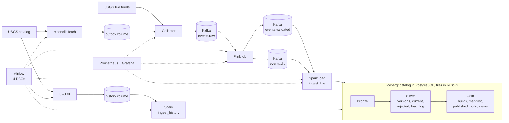

# Architecture

The map of the system: the flow, the tech stack, the folder structure and how the components are connected. This file is deliberately short. What each stage guarantees and where each piece of state lives is in [docs/architecture.md](docs/architecture.md). Why each choice was made is in [decisions.md](decisions.md). Conventions and contracts are in [design.md](design.md).

## 1. Flow



In words:

1. The **collector** polls two USGS feeds, validates and fingerprints each record, records unseen revisions as pending in SQLite, and sends them to `quakeflow.events.raw`. It marks a revision sent only when Kafka confirms.
2. The **Flink job** reads the raw text, validates it in SQL, drops exact repeats, and writes valid revisions to `quakeflow.events.validated` and rejected messages with their reason to `quakeflow.events.dlq`, transactionally.
3. The **Spark load** (`batch/ingest_live.py`) reads both topics and merges them into Bronze and Silver. Its last step records the Silver snapshots it ended with in `silver.load_log`.
4. **Gold** (`batch/build_gold.py`) reads exactly those snapshots, audits them against `configs/quality.yaml`, and publishes a new versioned build only if every check passes.
5. **Backfill** and **reconciliation** are the other two ways in. Backfill goes from the catalog to files to Spark. Reconciliation goes from the catalog to a file outbox to the collector, and from there down the normal path.
6. **Airflow** runs the batch work and keeps the Flink job alive. **Prometheus and Grafana** watch every stage.

## 2. Tech stack

| Layer | Technology | Version | Why it is here |
|---|---|---|---|
| Language | Python | 3.11 (3.10 inside the Spark image) | Collector, jobs, tests, DAGs |
| Messaging | Apache Kafka, KRaft, one broker | 3.9.0 | Durable, replayable buffer |
| Stream processing | Apache Flink, SQL | 2.2.1 with the Kafka SQL connector 5.0.0-2.2 | Validation, deduplication, transactional writes |
| Batch processing | Apache Spark, PySpark | 4.0.4 | Loads, backfill load, Gold build |
| Table format | Apache Iceberg | 1.12.0 (Spark 4.0 runtime) | Merges, snapshots, time travel |
| Catalog | PostgreSQL | 17.11 | Iceberg JDBC catalog, and the Airflow database |
| Object storage | RustFS (S3-compatible) | 1.0.0 | Iceberg data and metadata files |
| Orchestration | Apache Airflow, LocalExecutor, DockerOperator | 3.3.2, Docker provider 4.5.9 | Scheduling, retries, run history |
| Metrics | Prometheus, Pushgateway, kafka-exporter | v3.15.0, v1.11.4, v1.10.0 | Scrape what runs, push what does not |
| Dashboards | Grafana | 12.4.13 | One operations dashboard |
| Packaging | Docker Compose with profiles | | `core`, `streaming`, `batch`, `monitoring`, `orchestration` |
| Libraries (host and collector) | confluent-kafka, pydantic v2, prometheus-client, pyyaml, requests, boto3 | see `pyproject.toml` | |
| Tests and checks | pytest, ruff, promtool, actionlint | | |
| CI | GitHub Actions | | `ci.yml` on every push, `docker-build.yml` when image inputs change |

## 3. Folder structure

```
QuakeFlow/
├── prd.md  architecture.md  design.md  tasks.md  decisions.md  .rules.md   the project's documents
├── README.md                    the public front page
├── docker-compose.yml           every service, in profiles
├── pyproject.toml               dependencies, ruff and pytest settings
├── ingestion/                   collector
│   ├── live/                    poller.py (main loop), usgs_client.py
│   ├── change_detector.py       SQLite state: revisions, pending and published, outbox batches
│   ├── kafka_publisher.py       sends pending revisions, marks sent from the delivery callback
│   ├── outbox.py                file hand-over with Airflow, intake inside the collector's loop
│   ├── reconcile.py             commands Airflow runs: fetch, await-ack, await-published, prune
│   ├── historical_client.py     FDSN client (windows and updatedafter)
│   ├── resend.py                resend revisions Kafka lost
│   ├── metrics.py  healthcheck.py
├── schemas/earthquake.py        the event model
├── processing/                  normalize.py, record_hash.py
├── flink/
│   ├── sql/                     kafka_sources, validated_events, revision_tracking
│   └── resubmit.sh              resubmits the job from a checkpoint
├── batch/                       Spark jobs (run in the Spark image)
│   ├── ingest_live.py  ingest_history.py  backfill.py  verify_history.py
│   ├── build_gold.py  quality.py  load_log.py  sql_files.py  job_metrics.py
├── iceberg/
│   ├── sql/                     001 namespaces, 002 tables, 003 merges, 004 Gold tables, 005 Gold build
│   └── catalog/                 Spark catalog settings template
├── airflow/dags/
│   ├── incremental_pipeline.py  reconciliation.py  historical_backfill.py  flink_health.py
│   └── quakeflow_orchestration/ preflight, watermark, backfill_params, flink_health logic (standard library only)
├── configs/                     sources.yaml, kafka-topics.yaml, quality.yaml
├── docker/                      collector, flink, spark, airflow Dockerfiles, hash-locked requirements
├── infrastructure/              kafka/create_topics.py, storage/
├── monitoring/                  prometheus.yml, alerts.yml (+ tests), dashboards/, grafana/
├── scripts/                     validate_config.py, airflow_setup.py
├── benchmarks/                  run_benchmark.py, results/
├── tests/                       unit/, integration/, recovery/, fixtures/, support modules
├── docs/                        architecture, running, monitoring, data-dictionary, recovery-runbook, benchmarks, verification-log
├── .github/                     workflows/, dependabot.yml
├── data/                        local state and downloads, git-ignored
└── secrets/                     generated Airflow credentials, git-ignored
```

## 4. How the components are connected

All containers share the Compose network `quakeflow_default` and reach each other by service name. Host-side tools use `127.0.0.1`. Nothing is published on any other address.

| From | To | Over | Address |
|---|---|---|---|
| Collector | Kafka | Kafka protocol | `kafka:19092` |
| Collector | USGS | HTTPS | public |
| Flink (JobManager, TaskManager) | Kafka | Kafka protocol | `kafka:19092` |
| Spark containers | Kafka, PostgreSQL, RustFS | Kafka, JDBC, S3 | `kafka:19092`, `postgres:5432`, `rustfs:9000` |
| Host tools and tests | Kafka | Kafka protocol | `127.0.0.1:9092` |
| Airflow scheduler | Docker daemon | Unix socket | starts Spark, collector and Flink containers |
| Airflow containers | PostgreSQL | SQL | database `airflow`, role `airflow` |
| Airflow tasks | Flink REST | HTTP | `flink-jobmanager:8081` |
| Airflow, collector | each other | volume `reconcile-outbox` | files in `/outbox` |
| Airflow backfill | Spark | volume `quakeflow_history-files` | files in `/history` and `/data/history` |
| Prometheus | collector, Flink, Kafka exporter, Pushgateway | HTTP scrape | `:9108`, `:9249`, kafka-exporter, `:9091` |
| Spark jobs | Pushgateway | HTTP push | when `PUSHGATEWAY_URL` is set |

Published on the host, all on `127.0.0.1`: Kafka 9092, collector metrics 9108, Flink 8081, PostgreSQL 5432, RustFS 9000 and 9001, Prometheus 9090, Grafana 3000, Pushgateway 9091, Airflow 8080.

### Containers and profiles

| Profile | Containers |
|---|---|
| `core` | `quakeflow-kafka`, `quakeflow-collector` |
| `streaming` | `quakeflow-flink-jobmanager`, `quakeflow-flink-taskmanager` |
| `batch` | `quakeflow-postgres`, `quakeflow-rustfs`, and the `spark` service, which is never started by `up` and is run per job |
| `monitoring` | `quakeflow-prometheus`, `quakeflow-grafana`, `quakeflow-pushgateway`, `quakeflow-kafka-exporter` |
| `orchestration` | `quakeflow-airflow-migrate` (runs once), `-apiserver`, `-scheduler`, `-dag-processor` |

Containers that Airflow starts are not part of Compose: Spark (image `quakeflow/spark:4.0.4`), the collector image for reconciliation and backfill downloads, and the Flink image for resubmission. They join `quakeflow_default`, use named volumes, and take their credentials as private environment.

### Volumes

`kafka-data`, `collector-state`, `reconcile-outbox`, `flink-checkpoints`, `postgres-data`, `rustfs-data`, `spark-checkpoints`, `prometheus-data`, `grafana-data`, `airflow-logs`, and `quakeflow_history-files`, which Docker creates on first use. There is no backup of any of them.

### Airflow DAGs

| DAG | Schedule | Flow |
|---|---|---|
| `incremental_pipeline` | every 30 min | preflight, Spark `ingest_live` (records snapshots), `build_gold` |
| `reconciliation` | every 6 h | preflight, read watermark, fetch, wait for the collector's acceptance, advance watermark, wait for publication, prune |
| `historical_backfill` | manual | validate parameters, preflight, download, `ingest_history`, `verify_history`, `build_gold` |
| `flink_health` | every 5 min | check, then nothing or resubmit from a checkpoint and confirm |

All Spark tasks share the Airflow pool `quakeflow_spark` with one slot.
